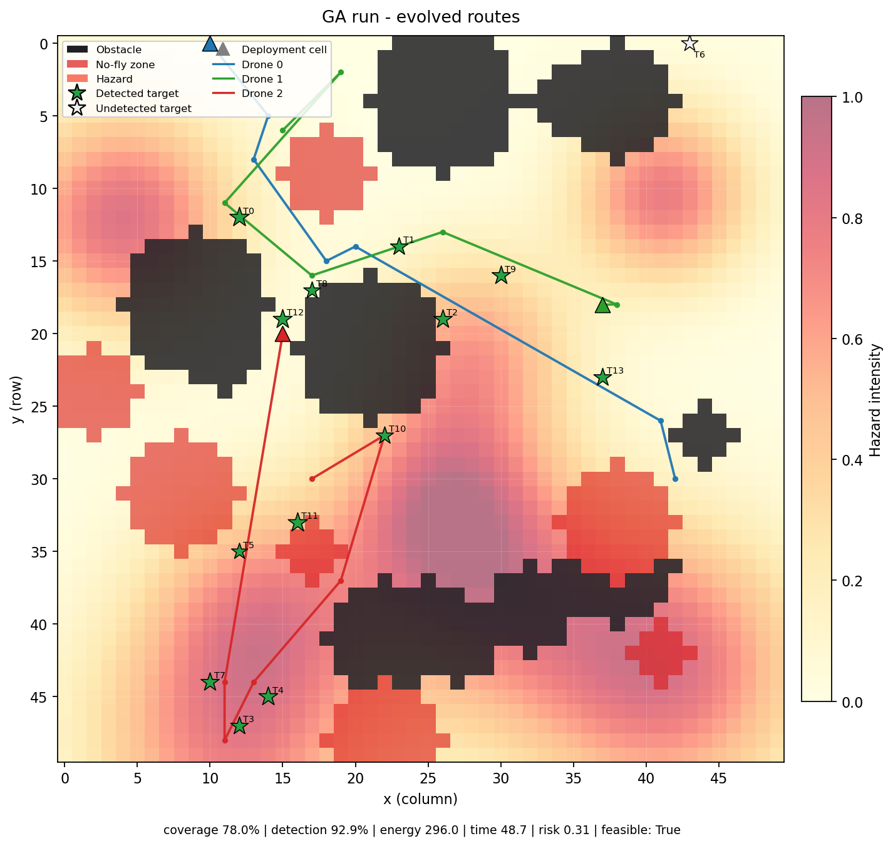
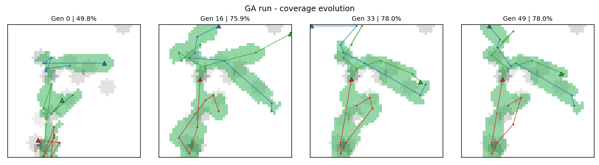

# UAV Disaster Surveillance Strategy Engine


A genetic-algorithm (GA) strategy engine that plans a three-drone surveillance
mission over a volatile 50 x 50 disaster grid. The engine evolves **deployment
positions**, **waypoint trajectories**, **speed settings** and **sensor
activation schedules**, while balancing coverage, target detection, energy,
flight time and hazard exposure.

<p align="center">
  
</p>
<p align="center"><em>Best evolved plan (seed 42): deployment cells, routes, hazard field and target zones.</em></p>

> **Course:** Artificial Intelligence, Assignment 2<br>
> **Program:** BSCS 5th Semester, Bahria University Lahore Campus<br>
> **Author:** Tayyab Mehmood (03-134242-092)<br>
> **Final report:** [Tayyab_Mehmood_03-134242-092_Assignment2_Report.pdf](report/Tayyab_Mehmood_03-134242-092_Assignment2_Report.pdf)

---

## Overview

The mission is a multi-objective optimisation problem with no single correct
answer. A plan must survey high-priority disaster zones without wasting battery
or flying through no-fly zones, obstacles and hazard pockets. The project uses a
GA because it can explore many complete fleet plans and improve them over
generations.

The repository is intentionally small and flat: six focused Python modules at
the project root, plus tests, results and the final report. Every requirement
from the assignment brief is implemented and documented below.

## Results at a glance

Equal budget: 3,000 evaluations per method, three seeds (42, 43, 44), 50 x 50
grid. Values are means +/- standard deviation.

| Method | Fitness | Priority-zone coverage | Targets | Energy | Time | Risk |
| --- | ---: | ---: | ---: | ---: | ---: | ---: |
| **Genetic algorithm** | **102.9 +/- 6.6** | **80.6%** | **13.3 / 14** | 372.9 | **72.4** | **0.225** |
| Random search | 78.4 +/- 5.9 | 65.0% | 11.3 / 14 | **348.9** | 79.5 | 0.272 |

The GA won on every seed (101.3, 110.1, 97.2 versus 85.2, 73.9, 76.3). The tuned
run (population 200, tournament 5, 10,000 evaluations) reached **109.4**,
**84.4% coverage** and detected all 14 targets. Random search used less energy
because it often took short direct routes; the GA spent energy to survey more
priority zones, which is the expected multi-objective trade-off.

### Coverage heatmaps across generations

<p align="center">
  
</p>

Coverage rises from **49.8%** at generation 0 to **75.9%** at generation 16 and
**78.0%** at generation 33, then stays at **78.0%** at generation 49. The
deployment cells and routes move as the GA learns where to start and where to
fly.

## Features

- **Evolved deployment positions** — one `(x, y)` start cell per drone.
- **Hybrid chromosome** — deployment cells plus waypoints with integer
  coordinates and discrete speed/sensor modes (78 genes per plan).
- **Multi-objective fitness** — priority-zone coverage, target detection,
  energy, flight time and hazard exposure, with hard-constraint penalties.
- **Custom spatial crossover** — swaps complete drone blocks, keeping each
  deployment cell paired with its evolved route.
- **Spatial mutation** — waypoint relocation, speed/sensor changes and
  deployment relocation.
- **Diversity control** — elitism plus random immigrants when progress stalls,
  directly addressing premature convergence.
- **Constraint handling** — dense leg sampling, obstacle/no-fly checks, range
  and battery limits, and a repair step before evaluation.
- **Required visualisations** — convergence, evolved paths, coverage heatmap,
  coverage evolution, comparison and sensitivity plots.
- **Reproducible experiments** — GA vs random search and population/mutation/
  tournament sweeps from the CLI.

## Project structure

The code is intentionally flat: six focused modules at the project root, plus
tests, results and the final report.

```text
uav-strategy-engine/
├── config.py          # environment, fleet, fitness and GA settings
├── model.py           # targets, grid, priority map, drones, chromosome
├── simulation.py      # constraints, repair, evaluator, coverage
├── genetic.py         # population, selection, crossover, mutation, optimizer
├── experiments.py     # random-search baseline and sensitivity analysis
├── plots.py           # mission, convergence, coverage and sensitivity plots
├── main.py            # CLI entry point
├── requirements.txt
├── tests/             # 47 pytest tests
├── results/           # final run artifacts and evidence
└── report/            # final 4-page PDF report
```

## Quick start

Requires Python 3.10+ (tested on Python 3.12, Ubuntu 24.04).

```bash
git clone https://github.com/ChTayyabMehmood/uav-strategy-engine.git
cd uav-strategy-engine

python3 -m venv .venv
source .venv/bin/activate
pip install -r requirements.txt
```

Run the default GA experiment:

```bash
python main.py
```

Run the complete comparison used in the report:

```bash
python main.py --mode compare --seeds 3
```

## Commands

| Command | Purpose |
| --- | --- |
| `python main.py` | Default GA run (population 60, 50 generations, seed 42) |
| `python main.py --mode random` | Equal-budget random-search baseline |
| `python main.py --mode compare --seeds 3` | GA vs random search over seeds 42–44 |
| `python main.py --mode sensitivity` | Population, mutation and tournament sweeps |
| `python main.py --mode sensitivity --full-factorial` | Full three-parameter grid |
| `python main.py --population 200 --tournament-size 5` | Tuned GA run from the report |

Useful options:

| Option | Default | Meaning |
| --- | --- | --- |
| `--seed` | 42 | environment and GA seed |
| `--population` | 60 | population size |
| `--generations` | 50 | generation limit |
| `--mutation-rate` | 0.20 | per-waypoint mutation probability |
| `--tournament-size` | 3 | selection pressure |
| `--crossover-rate` | 0.9 | crossover probability |
| `--elitism` | 2 | feasible elites per generation |
| `--waypoints` | 6 | waypoints per drone |
| `--drones` | 3 | fleet size |
| `--targets` | 14 | number of disaster targets |
| `--output-dir` | `results` | output directory |

## How it works

### Chromosome

```text
Chromosome
├── deployments[3]      # evolved (x, y) start cell per drone
└── routes[3]
    └── waypoints[6]
        ├── x, y        # integer grid coordinates
        ├── speed       # 0 slow, 1 cruise, 2 fast
        └── sensor      # 0 off, 1 medium, 2 high
```

A leg from the previous point to waypoint `w` uses waypoint `w`'s speed and
sensor settings. The deployment cell is the first point of the route. In total,
one plan stores 3 x 2 deployment values plus 3 x 6 x 4 waypoint values =
**78 genes**.

### Fitness

```text
raw = 100 * coverage
    +  50 * detection_rate
    -  20 * normalized_energy
    -  15 * normalized_time
    -  30 * normalized_risk
```

Coverage is the share of **priority-zone area** surveyed by the active sensors.
Every target owns a circular priority zone; covering the whole zone contributes
its full weight. Detection is the share of targets found. Energy, time and risk
are normalised before subtraction.

Hard violations add a large penalty:

```text
penalty = 1000 + 50 * violation_count + 25 * sum(min(magnitude, 10))
```

Feasibility is also stored separately, so an invalid plan can never outrank a
valid one during selection or elitism.

### Genetic loop

1. Initialise deployment cells with spacing and build valid target-directed routes.
2. Select parents with tournament selection.
3. Swap complete drone blocks (deployment + route) with block-suffix crossover.
4. Mutate waypoints, speed/sensor modes and deployment cells.
5. Repair blocked or out-of-bounds routes.
6. Copy the best feasible plans and fill the rest of the population.
7. Inject random immigrants if progress stalls for four generations.
8. Stop after 50 generations or an optional stagnation limit.

## Output artifacts

A GA run writes:

| File | Content |
| --- | --- |
| `run_config.json` | CLI arguments and complete configuration |
| `best_solution.json` | Deployments, routes, metrics and violations |
| `fitness_history.csv` | Best/mean fitness and mission metrics per generation |
| `mission_map.png` | Environment, deployment cells and evolved paths |
| `mission_map_initial.png` | Generation-0 best plan |
| `convergence.png` | Best vs average feasible fitness |
| `coverage_heatmap.png` | Priority-zone coverage and visitation density |
| `coverage_evolution.png` | Coverage heatmaps at generations 0, 16, 33 and 49 |

Random, compare and sensitivity modes additionally write their history,
summary CSVs and comparison/sensitivity plots. Final evidence is committed under
`results/`.

## Tests

```bash
python3 -m pytest -q
```

**47 tests pass.** The suite covers environment generation, priority zones,
chromosome deployments and serialisation, repair and constraints, coverage and
fitness calculations, genetic operators, elitism, reproducibility and
termination.

## Report

The final **4-page technical report** is included as a PDF:

[`report/Tayyab_Mehmood_03-134242-092_Assignment2_Report.pdf`](report/Tayyab_Mehmood_03-134242-092_Assignment2_Report.pdf)

It covers the chromosome and fitness rationale, deployment and coverage
results, coverage heatmaps across generations, hyperparameter sensitivity
(population, mutation, selection pressure), and the comparison with random
search.

## Notes and limitations

- All units are normalised simulation units, not real UAV specifications.
- Flight is an offline straight-leg model with no real-time control, wind,
  collision avoidance or probabilistic sensing.
- Obstacles and no-fly zones are hard constraints.
- Drones fly in parallel; mission time is the slowest drone's duration.
- Route length is fixed at six waypoints for clean crossover and repair.
- The GA is a stochastic heuristic and does not guarantee a global optimum.
